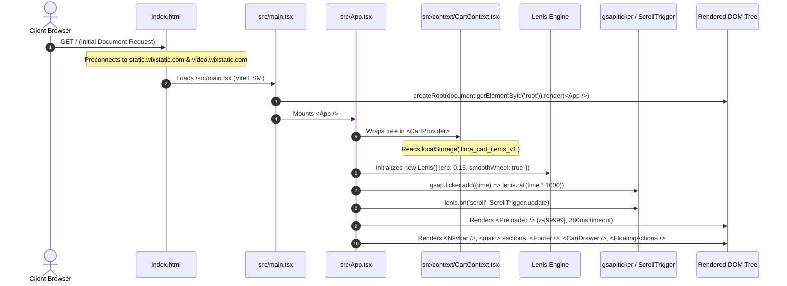
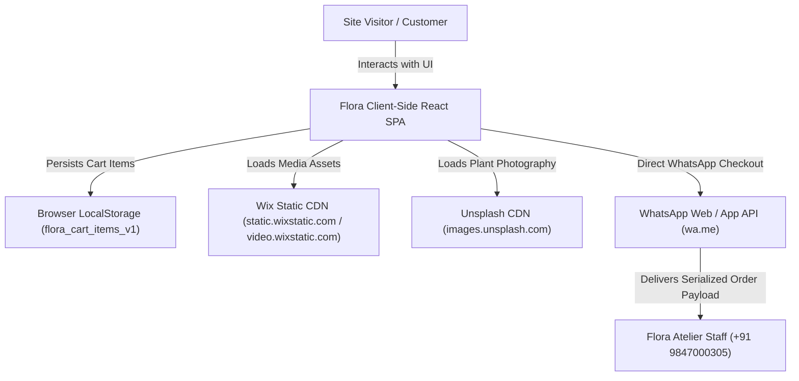

# Phase 1: System Architecture & Initial Orientation

> **File:** `audit/00_SYSTEM_ARCHITECTURE_AND_ORIENTATION.md`  
> **Target Scope:** Root Architecture, Environmental Boundaries, Entrypoints, Dependency Graph, Design Tokens  
> **Status:** Phase 1 Complete (Context Established)

---

## 1. System Overview & Physical Real-World Context

Flora Pots & Plants is a specialized, interactive digital experience for a boutique horticultural atelier and ceramic studio based in **Appadath Building, Nellikuzhi, Kothamangalam, Kerala 686691**.

The digital platform serves two operational functions:
1. **Brand Showcase & Horticultural Atelier Presentation:** High-aesthetic storytelling inspired by modern architectural studios (specifically reverse-engineered from [New Engen](https://newengen.com/)), emphasizing acclimatized living tropical flora, hand-carved terracotta vessels, fluted fiberglass planters, and architectural silk botanicals.
2. **Conversational E-Commerce Conversion Engine:** A client-side shopping bag and interactive plant-pot bundling engine that bypasses traditional payment gateway checkouts, instead serializing orders into structured WhatsApp consultation payloads routed directly to the atelier staff in Kerala (`+91 9847000305`).

---

## 2. Technology Stack & Runtime Environments

| Category | Technology | Version | Architectural Responsibility |
|---|---|---|---|
| **Runtime / UI** | React | `^18.3.1` | Declarative component tree, context provider tree, virtual DOM. |
| **DOM Renderer** | React DOM | `^18.3.1` | Client-side DOM mounting via `createRoot` in `src/main.tsx`. |
| **Language** | TypeScript | `^5.7.3` | Strict type checking (`tsc -b`), interface contracts in `src/types/index.ts`. |
| **Bundler & Dev Server** | Vite | `^6.1.0` | ESM-based compilation, asset hashing, rollup production bundling. |
| **Styling & CSS** | Tailwind CSS | `^3.4.17` | Utility-first CSS, custom font declarations, responsive utility generation. |
| **PostCSS / Autoprefixer** | PostCSS | `^8.4.49` | Vendor prefixing and CSS processing. |
| **Animation (Kinetic)** | GSAP + ScrollTrigger | `^3.15.0` | FLIP bounding-rect scrubbing, pinned accordion scrubbing, ticker coordination. |
| **Smooth Scrolling** | Lenis | `^1.3.27` | Virtualized momentum scrolling, smooth wheel normalization, GSAP ticker binding. |
| **Animation (Component)**| Framer Motion | `^12.42.0` | Modal drawers (`CartDrawer`), exit transitions (`AnimatePresence`), scrubbed typography (`EditorialManifesto`). |
| **Visual Delight** | Canvas Confetti | `^1.9.4` | Particle celebration when user customizes a bespoke plant-pot bundle. |
| **Iconography** | Lucide React | `^1.16.0` | Clean SVG symbols (ShoppingBag, ArrowUpRight, Phone, MapPin, Truck, etc.). |

---

## 3. Directory Map & Source Organization

```
/home/arshad/Projects/FLORA_WEBSITE/
├── index.html                       # HTML5 entrypoint, viewport-fit=cover, resource hints (preconnect)
├── package.json                     # Dependency manifests and npm script definitions
├── postcss.config.js                # PostCSS plugins (Tailwind, Autoprefixer)
├── tailwind.config.js               # Theme definitions, custom colors, fontFamily extensions
├── tsconfig.json                    # TypeScript compiler options (strict, ES2020)
├── tsconfig.node.json               # Node-specific TS configuration for Vite
├── vite.config.ts                   # Vite configuration with React plugin
├── public/                          # Static assets and favicons
└── src/
    ├── main.tsx                     # Mounts React DOM root into document.getElementById('root')
    ├── App.tsx                      # Root component: Lenis engine, GSAP ticker, CartProvider, Layout
    ├── index.css                    # Tailwind imports, custom font faces, .site-max fluid scaling
    ├── types/
    │   └── index.ts                 # Core type declarations (Product, CartItem, VideoReel, Testimonial)
    ├── data/
    │   └── catalog.ts               # Static catalog records, studio coordinates, reels, testimonials
    ├── context/
    │   └── CartContext.tsx          # Shopping cart state, localStorage persistence, WhatsApp generator
    └── components/
        ├── Preloader.tsx            # 380ms kinetic brand reveal mask (New Engen style)
        ├── Navbar.tsx               # Fixed header with 44px pill geometry & scroll threshold morphing
        ├── HeroSection.tsx          # FLIP scroll deck, concurrent 4-video loop, arched mountain badge
        ├── EditorialManifesto.tsx   # Word-by-word Framer Motion scrubbed reading experience
        ├── ServicesSection.tsx      # Pinned 260vh accordion scrub track with split preview pane
        ├── CatalogSection.tsx       # Live filterable catalog grid (search, category, sort)
        ├── PlantPotCustomizer.tsx   # 2-step pairing studio with 10% bundle math & confetti trigger
        ├── VideoReelsSection.tsx    # 9:16 vertical video player with sound toggle & quick-add
        ├── AwardsSection.tsx        # Editorial distinction list with hover transformations
        ├── CareGuideSection.tsx     # Accordion FAQ for Kerala tropical plant maintenance
        ├── SocialProofSection.tsx   # Patron stories, live showroom ambient telemetry, counter badges
        ├── StoreLocationSection.tsx # Showroom coordinates, Google Maps deep link, phone actions
        ├── Footer.tsx               # Giant CTA, 3-column navigation, full-bleed SVG back-to-top
        ├── CartDrawer.tsx           # Slide-out cart panel, free shipping meter, customer note inputs
        ├── icons/
        │   └── InstagramIcon.tsx    # Custom inline SVG Instagram glyph
        └── ui/
            ├── AnimatedCounter.tsx  # Linear interpolated number incrementer on scroll
            ├── DualTextButton.tsx   # Pill button with dual-mask rolling text hover effect
            └── SplitText.tsx        # Letter/word level staggered entrance animations
```

---

## 4. Entrypoint & Root Mount Pipeline

Tracing execution from cold start in the browser:



### Critical Initialization Details (`src/App.tsx` Lines 71-100)
1. **Lenis Configuration:**
   - `lerp: 0.15`: Provides smooth viscous inertia without lagging behind user input.
   - `wheelMultiplier: 1.25`: Compensates for low-resolution mouse wheels.
   - `smoothWheel: true`: Smooths wheel delta events.
   - `syncTouch: false`: Retains native 1:1 hardware touch response on mobile viewports.
2. **GSAP Ticker Synchronization:**
   - `gsap.ticker.lagSmoothing(0)`: Disables lag smoothing so GSAP animations do not jump when frames are dropped during initial media decode.
   - `lenis.raf(time * 1000)`: Links Lenis's internal delta clock directly to GSAP's requestAnimationFrame loop.
3. **Resize Observer Hook:**
   - Window resize events call `ScrollTrigger.refresh()` followed by `lenis.resize()`, preventing miscalculated pin trigger boundaries.

---

## 5. Design System Tokens & Spatial Scaling Architecture

### 5.1 Color Palette Tokens

The codebase adheres strictly to 5 core color tokens defined across `tailwind.config.js` and `src/index.css`:

```
Base Pine (Primary Dark):        #334238   (tailwind: bg-ngen-green, text-ngen-green)
Charcoal (Dark Neutral):         #242424   (tailwind: bg-ngen-charcoal, text-ngen-charcoal)
Chalk Cream (Light Canvas):      #FAF2E8   (tailwind: bg-ngen-cream, text-ngen-cream)
Coral Peach (Primary Accent):    #FF9C94   (tailwind: bg-ngen-peach, text-ngen-peach)
Electric Lime (Secondary Accent): #CCE561  (tailwind: bg-ngen-lime, text-ngen-lime)
Deep Pine Shadow:                #243329   (tailwind: bg-ngen-darkgreen)
Fern Muted Border:               #618C70   (tailwind: text-ngen-fern)
```

**Constraint Enforced:** Zero emojis anywhere in code, markup, or UI text. All indicators use custom SVG geometric glyphs or Lucide React icons.

### 5.2 Fluid Spatial Architecture: `.site-max`

To eliminate the "zoomed-out" appearance common to fixed-width templates (`max-w-7xl` = 1280px), Flora uses New Engen's fluid proportional scaling architecture:

```css
/* src/index.css */
.site-max {
  max-width: 1920px;
  margin-left: auto;
  margin-right: auto;
  padding-left: clamp(1.25rem, 3.33vw, 4rem);
  padding-right: clamp(1.25rem, 3.33vw, 4rem);
}
```

#### Metrics Across Viewports:
- **Mobile (393px):** Horizontal padding = `20px` (`1.25rem`). Available content width = `353px` (89.8% of screen).
- **Tablet (768px):** Horizontal padding = `25.5px` (`3.33vw`). Available content width = `717px` (93.3% of screen).
- **Laptop (1440px):** Horizontal padding = `47.95px` (`3.33vw`). Available content width = `1344px` (93.3% of screen; total container spans 99.6% before padding).
- **Ultrawide (1920px+):** Horizontal padding = `64px` (`4rem`). Container clamps to `1920px`, centering gracefully on 4K displays.

### 5.3 Typography Hierarchy

- **Display Serif / Sans:** `'Cabinet Grotesk', 'Syne', -apple-system, BlinkMacSystemFont, sans-serif` (Heavy uppercase headlines: `BOTANICAL IS OUR CRAFT.`, `font-black`, letter spacing `-0.04em`).
- **Body Sans:** `'Plus Jakarta Sans', 'Inter', sans-serif` (Paragraphs, descriptions, narrative copy, high legibility).
- **Technical Monospace:** `'JetBrains Mono', monospace` (Coordinates, metrics, prices, timestamps, badges, letter spacing `0.1em`).

---

## 6. Actors & Operational Boundaries



1. **Site Visitor (Anonymous Client):** Navigates catalog, plays videos, customizes plant-pot pairings, adds items to bag. Has write access only to client-side state and browser `localStorage`.
2. **Flora Atelier Staff (Fulfillment):** Receives structured WhatsApp messages specifying quantities, product IDs, pot colors, delivery address, and computed rupee subtotals.
3. **Asset CDNs (Wix & Unsplash):** Static read-only hosts for showroom videos (`.mp4`), poster frames, and botanical photography. Handled with preconnect hints in `index.html`.
4. **Third-Party Services (Google Maps / Instagram):** External outbound redirect targets for showroom navigation and social community engagement.
