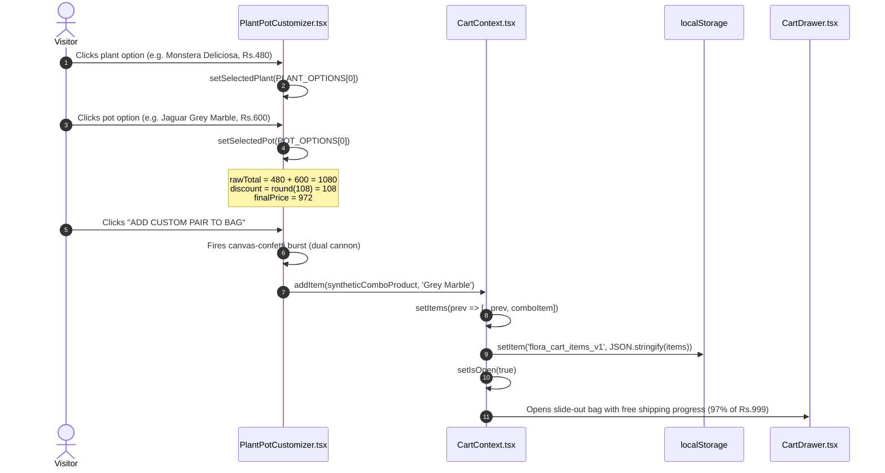
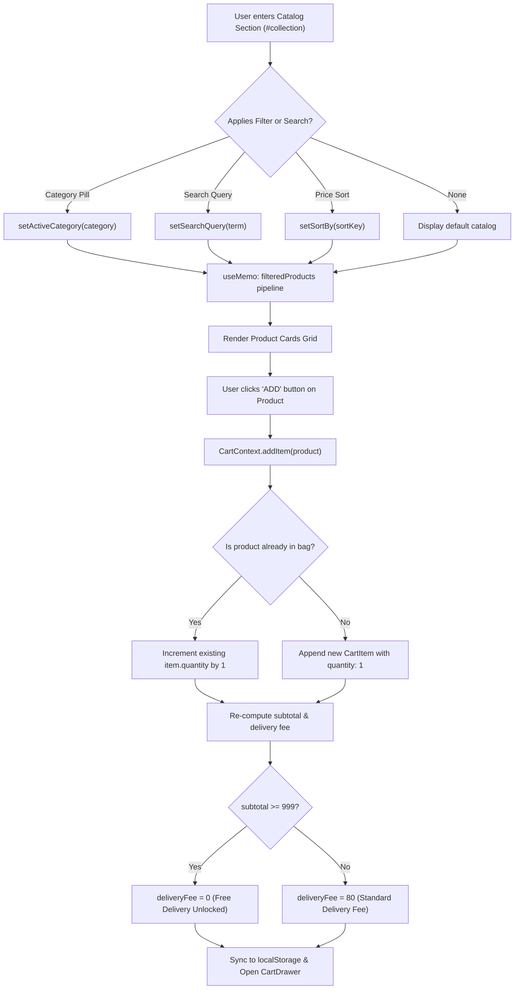
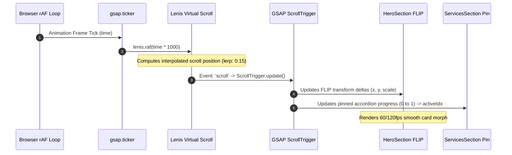

# Phase 3: Global Invariants & Workflow Reconstruction

> **File:** `audit/03_GLOBAL_INVARIANTS_AND_WORKFLOW_RECONSTRUCTION.md`  
> **Target Scope:** End-to-End User Workflows, Multi-Module Invariants, Trust Boundaries, Fragility Clusters  
> **Status:** Complete (Global Context Synthesized)

---

## 1. End-to-End Workflow Reconstruction

### 1.1 Workflow A: The Customizer Studio Pairing Journey
Traces how a user configures a bespoke living plant and artisanal pot combination, derives bundle pricing, and commits it to the cart.



#### Persistent Assumptions Across Workflow A:
1. `PlantOption.price` and `PotOption.price` are non-negative numbers.
2. The synthetic compound ID `combo-${plant.id}-${pot.id}` will never collide with a pure catalog product ID.
3. The cart automatically considers the combo as a single distinct product line item with its own unique name and description.

---

### 1.2 Workflow B: Direct Catalog Browsing & Cart Accumulation
Traces how a user discovers items through search and filters, commits items to the bag, and observes free delivery thresholds.



---

### 1.3 Workflow C: WhatsApp Order Serialization & Fulfillment Handoff
Traces the final checkout step where client-side memory is serialized into an external communication protocol.

1. **User Input Phase:** User opens `CartDrawer` and optionally enters their Name, Delivery Address in Kerala, and Special Notes.
2. **Payload Construction (`CartContext.generateWhatsAppOrderUrl`):**
   - Header: `Hello Flora Pots & Plants! I would like to place an order from your website:`
   - Iteration: Numbered list of items: `${index + 1}. ${quantity}x ${product.name} (${potColor}) - Rs.${lineTotal}`
   - Summary: `Subtotal: Rs.${subtotal}`, `Delivery: ${deliveryText}`, `Total Amount: Rs.${totalAmount}`
   - Customer Details: Appends Name and Address if provided.
   - Closing: `Please confirm product availability and dispatch schedule. Thank you!`
3. **URL Encoding & Dispatch:** The string is encoded with `encodeURIComponent` and opened via `window.open(url, '_blank')`.
4. **Physical Atelier Intake:** Staff in Nellikuzhi receives the message directly in WhatsApp Business, verifies plant stock in the nursery, checks pot inventory in the pottery warehouse, and sends bank UPI QR or cash-on-delivery confirmation.

---

### 1.4 Workflow D: Lenis & GSAP Scroll Engine Synchronization Pipeline
Traces the continuous animation frame lifecycle governing the site's kinetic physics.



---

## 2. Multi-Module Global Invariants

These mathematical and architectural invariants hold true across the entire codebase at all times:

| Invariant ID | Definition / Formula | Scope | Enforcement Mechanism |
|---|---|---|---|
| **INV-01: Zero Emojis** | No unicode emojis exist in UI copy, buttons, badges, or alt attributes. | Entire Project | Checked via strict design system guidelines & build audit. |
| **INV-02: Delivery Calculation** | `deliveryFee === (subtotal >= 999 || subtotal === 0 ? 0 : 80)` | Global Cart | Calculated strictly in `CartContext.tsx` render pass. |
| **INV-03: Cart Total Identity** | `totalAmount === subtotal + deliveryFee` | Global Cart | Pure derived property in `CartContext.tsx`. |
| **INV-04: Non-Negative Quantity** | `∀ item ∈ items: item.quantity > 0` | Global Cart | `updateQuantity` automatically prunes items with quantity `<= 0`. |
| **INV-05: Desktop Header Height** | In scrolled state, all interactive navbar capsules equal `44px` (`h-11`). | Navigation | Fixed Tailwind utility classes (`h-11`) across logo, links, and buttons. |
| **INV-06: Fluid Screen Usage** | `.site-max` spans between 89.8% (mobile) and 99.6% (1440px desktop) width. | All Layout Sections | `clamp(1.25rem, 3.33vw, 4rem)` CSS definition in `src/index.css`. |
| **INV-07: Hero Array Bounds** | `0 <= activeReelIndex < 4` | Hero Section | Clamped via modulo: `(prev + 1) % 4`. |
| **INV-08: Services Array Bounds**| `0 <= activeIdx < 5` | Services Section | Clamped via `Math.min(Math.floor(progress * total), total - 1)`. |

---

## 3. Trust Boundaries & Attack Surface Analysis (Context Only)

*Note: In accordance with `audit-context-building`, this section defines data boundaries and structural interfaces without declaring vulnerabilities.*

```
Boundary 1: [Browser Client] <---> [localStorage API]
  - Storage Key: 'flora_cart_items_v1'
  - Data Type: Serialized JSON Array of CartItem objects
  - Trust Level: Untrusted input on hydration. Handled defensively via try/catch and fallback to [].

Boundary 2: [User Text Inputs] <---> [WhatsApp Checkout URL]
  - Inputs: Customer Name, Delivery Address, Special Notes
  - Output: URI-encoded string parameter inside https://wa.me/919847000305?text=...
  - Trust Level: User-controlled string. Encoded safely via encodeURIComponent().

Boundary 3: [Third-Party Media CDNs] <---> [Browser Image/Video Elements]
  - Domains: static.wixstatic.com, video.wixstatic.com, images.unsplash.com
  - Trust Level: External asset availability. If CDN stalls, video elements display static poster images.

Boundary 4: [DOM Geometry & Viewport] <---> [GSAP FLIP Calculations]
  - Mechanism: getBoundingClientRect() on live DOM nodes
  - Trust Level: Layout shifts during dynamic font loading or window resize. Handled via ScrollTrigger.refresh() and clearProps: 'all'.
```

---

## 4. Complexity & Fragility Clusters

Analysis of areas where state coupling, timing dependencies, or DOM interactions require special awareness:

### Cluster 1: GSAP FLIP Bounding Box Calculation Timing (`HeroSection.tsx`)
- **Nature of Complexity:** Hero cards dynamically calculate X/Y translation deltas to fly from the fanned hero deck into the Selected Work grid slots.
- **Fragility Point:** If `getBoundingClientRect()` executes before custom fonts finish loading or before images expand their containers, computed deltas will be misaligned by several pixels.
- **Mitigating Architecture:** `HeroSection` clears inline transforms prior to measurement (`clearProps: 'all'`) and relies on `ScrollTrigger.refresh()` triggered on window resize.

### Cluster 2: Simultaneous Video Playback & Mobile Power Policies (`HeroSection.tsx`)
- **Nature of Complexity:** The hero section plays 4 high-definition video loops concurrently.
- **Fragility Point:** Mobile operating systems (iOS Safari, Android Chrome) enforce aggressive battery-saving policies that pause non-visible or simultaneous video elements.
- **Mitigating Architecture:** All videos are explicitly marked `muted`, `playsInline`, and `autoPlay`. In addition, visibility listeners (`visibilitychange`, `window.focus`) re-invoke `.play()` when returning to the tab.

### Cluster 3: Virtual Scroll vs. Hardware Momentum (`src/App.tsx`)
- **Nature of Complexity:** Lenis virtualizes mouse wheel scrolling by intercepting native events and updating `window.scrollTo` on an interpolated ticker.
- **Fragility Point:** If `syncTouch` were enabled on mobile, touch gestures would stutter due to fighting native hardware kinetic scrolling.
- **Mitigating Architecture:** `syncTouch: false` explicitly preserves native touch scrolling on mobile while running smooth interpolation strictly for desktop wheel events.

### Cluster 4: Dual Sticky Accordion Mode (`ServicesSection.tsx`)
- **Nature of Complexity:** Desktop uses a 260vh pinned GSAP scroll scrub; mobile uses a natural vertical accordion.
- **Fragility Point:** A user resizing the browser between desktop and mobile while scrolled midway through the pinned track could leave the track stuck.
- **Mitigating Architecture:** Uses `gsap.context()` inside `useEffect` and isolates desktop logic using `matchMedia('(min-width: 1024px)')`. When unmounting or resizing, `ctx.revert()` tears down all pinned styles cleanly.
